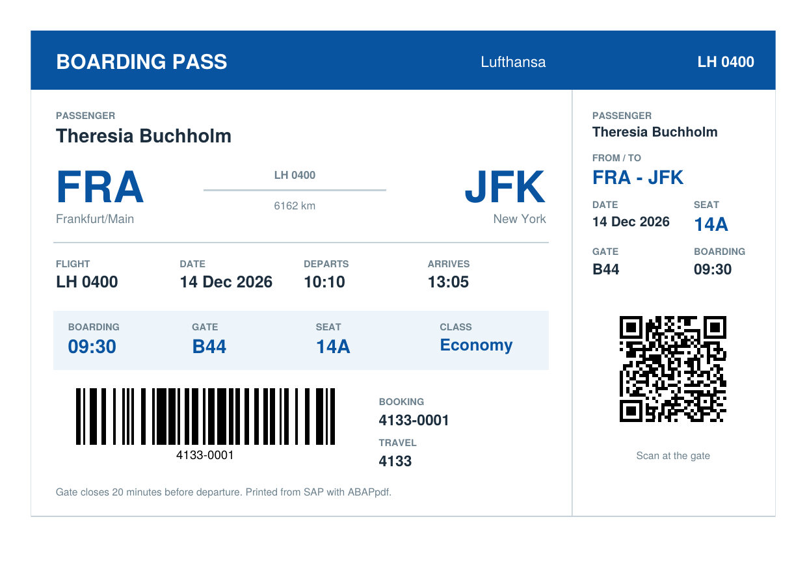

# ABAPpdf demo: boarding pass

A boarding pass for each booking of the ABAP flight model (`/DMO`), designed in the [ABAPpdf](https://github.com/IbrahimAsiriDev/abappdf-cloud) designer and printed in ABAP.



The demo shows:

- An A5 landscape form with shapes, a Code 128 barcode and a QR code.
- Data from several `/DMO` tables: booking, customer (passenger), carrier, connection and airport.
- A Fiori elements list of bookings with a **Boarding pass** link that opens the PDF.

Gate, seat and boarding time are not part of `/DMO`. The demo derives them from the booking, so the values are examples only.

## Requirements

- [ABAPpdf Cloud](https://github.com/IbrahimAsiriDev/abappdf-cloud) **v0.1.1 or higher**, installed and working.
- The ABAP flight reference scenario (`/DMO`) with data. It is part of the SAP BTP ABAP environment trial.

## Installation

1. Create a package, for example `ZABAPPDF_BOARDING` (on the BTP trial, under `ZLOCAL`).
2. Link this repository with the abapGit plug-in for ADT, pull, and activate all objects (Ctrl+Shift+F3).
3. **Create the HTTP service by hand**: abapGit does not support this object type. In the package, create the HTTP service `ZABAPPDF_BP_HTTP` with handler class `ZCL_ABAPPDF_BP_HTTP`.
4. **Create the service binding by hand**: `ZUI_ABAPPDF_BP_O4`, binding type **OData V4 - UI**, service definition `ZUI_ABAPPDF_BP`. Activate it and choose **Publish**.
5. Import the form: open the ABAPpdf designer, choose **Import XML**, select [`forms/ZPDF_BOARDING_PASS.xml`](forms/ZPDF_BOARDING_PASS.xml), open the form and choose **Save version**.

## Try it

- **Fiori:** open the service binding `ZUI_ABAPPDF_BP_O4`, select the entity **Booking** and choose **Preview**. Choose **Go**, then **Boarding pass** in any row.
- **Console:** run `ZCL_ABAPPDF_BOARDING` with F9. It prints the boarding pass of the first booking and shows its data.
- **URL:** `/sap/bc/http/sap/zabappdf_bp_http?travel=2&booking=2`

## Objects

| Object | Purpose |
|---|---|
| `ZCL_ABAPPDF_BOARDING` | Reads the booking data and prints form `ZPDF_BOARDING_PASS` |
| `ZCL_ABAPPDF_BP_HTTP` | HTTP handler: returns the boarding pass PDF |
| `ZC_ABAPPDF_BP_BOOKING` | Bookings with passenger, route and the boarding pass link |
| `ZUI_ABAPPDF_BP` | Service definition for the Fiori list |
| `forms/ZPDF_BOARDING_PASS.xml` | The form, to import in the ABAPpdf designer |

## Use it in your code

```abap
DATA(lv_pdf) = zcl_abappdf_boarding=>print(
  iv_travel_id  = '00000002'
  iv_booking_id = '0002' ).
```

## License

[MIT](LICENSE)
